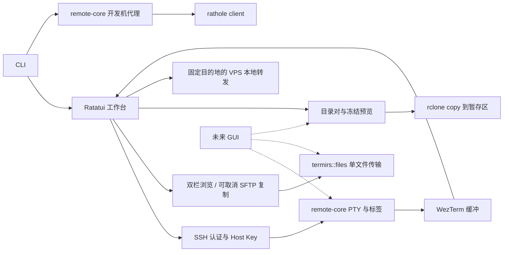

# 从 TermiRs 演进

本仓库从 [TermiRs 0.3.4 / ab1910e](https://github.com/caelansar/termirs/tree/ab1910e4e251bf0b92271203b8f4dc25d8a5d015) 保留 Git 历史；MIT，版权见根 LICENSE。选择直接扩展这个客户端：它已有能跑本地 SSH 服务端的测试、真正的 VT 终端和双栏 SFTP。替换协议栈，会丢掉这些最值钱的东西。原版构建和运行记录见 [BASELINE](../testing/BASELINE.md)。

## 谁拥有哪段状态

| 上游源码 | 已有路径（源码检查） | 工作台的取舍 |
|---|---|---|
| `src/main.rs`、`src/events.rs` | 单个 Tokio runtime；Crossterm 输入、条件 tick 与网络事件汇入容量 100 的队列 | 保留事件驱动；后台标签不应触发前台无意义重绘 |
| `src/app.rs`、`src/key_event/` | 原版 `AppMode::Connected` 独占一个 client、reader 取消令牌和屏幕；Disconnect 不带来源。Tab 在表单和文件浏览器里用于换焦点 | 原版没有多终端。保留模式路由，在其外管理非前台终端；断开必须寻址会话实例 |
| `src/async_ssh_client.rs` | russh 认证、PTY/shell、resize、按字节读取、SFTP 收发以及端口转发 | 每个普通终端各建 SSH；Files 临时 shell 仅借原 SSH 连接的 channel，关闭时归还 Files |
| `src/ui/terminal.rs`、`src/terminal/selection.rs` | WezTerm 解析、滚动、搜索与 Ratatui 绘制；默认历史 2000 行，上限 5000 | 保留转义序列处理；暂不把含 UI 类型的 TerminalState 移入 Core |
| `src/filesystem/`、`src/ui/file_explorer.rs`、`src/transfer.rs` | 本地与 SFTP 文件系统适配、双栏视图、复制队列与进度。键盘 c/v 跨栏复制，d 需确认 | 复用目录视图；路径直达、重命名和建目录已在真实控制台验收。远端列表按当前目录加载，大单目录仍会收集到 Vec |
| `src/config/` | 连接、SSH config 导入、固定服务端公钥、TOML 持久化 | 主机名/用户名派生只用于读取旧设备凭证。Windows 新密码与私钥口令使用当前用户的 DPAPI；rathole token 留在单独的受限配置中 |

`Cargo.lock` 固定 russh 0.57.0、russh-sftp fork ed99dd3、WezTerm fork 7bc8751、ssh2-config fork 1bcf78d、ratatui-async-explorer 0.3.4。保留锁文件，不借初始化顺便升级。

## 系统边界

实线表示直接组件关系，虚线表示目标架构。已抽出 PTY 输入输出、会话身份和开发机代理进程管理。文件复制及目录同步的执行器独立于页面。未来 GUI 直接依赖 Core；无需 HTTP 层。

## 使用真实设备前的两道门

1. `SshClient::check_server_key` 在用户认证前统一验证 shell、SFTP 及端口转发的对端公钥。同一 host:port 的设备配置复用已保存身份，旧配置中的 pin 继续生效。新设备先经可信渠道核对指纹；只有配置写入成功才允许用该 key 连接。公钥变化或已存公钥损坏均拦截。[真实 SSH 服务端验收](../testing/HOST_KEY.md)
2. 新隧道仅服务于明确授权的设备与目录。VPS 上的 SSH 转发入口只绑定回环，校验两段 SSH 身份；开发机代理只读取权限受限的管理员配置，Token 不进入工作台、命令行或日志。普通远端端口转发最多接受 64 条活动连接、排队 16 条，满时关闭额外通道。启用 --log 后使用 4 MiB 的当前日志和一份轮换备份。
