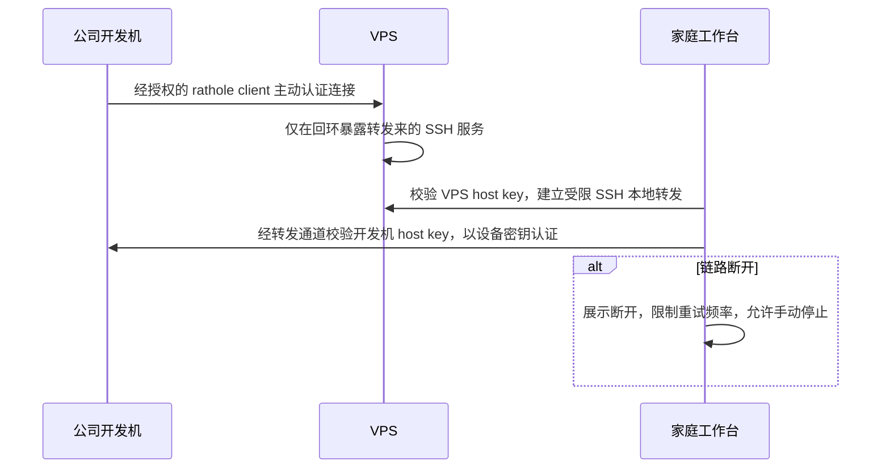
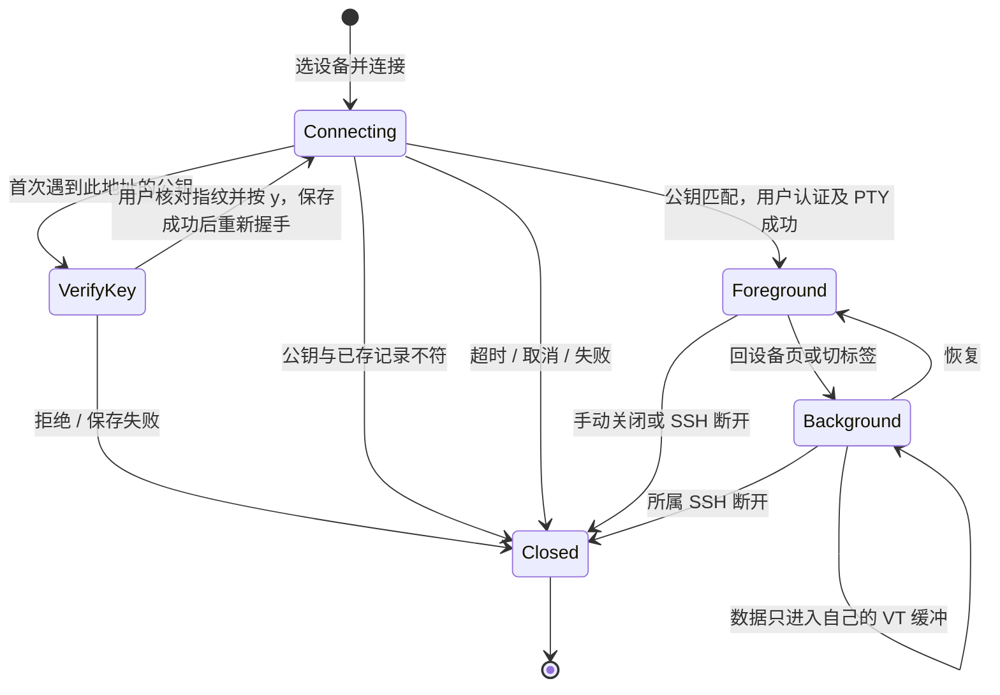
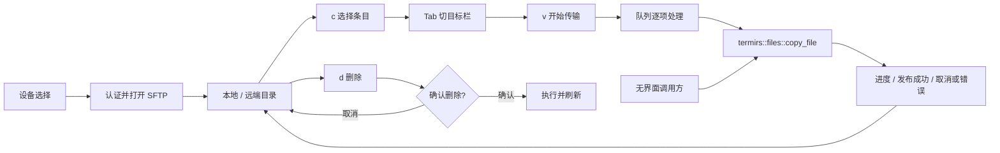

# 连接、会话和文件各走哪条路

## 经 VPS 建立隧道

rathole 接收客户端连接的端口与回环上的转发服务端口是两回事。[rathole 的 server/client 配置](https://github.com/rathole-org/rathole)分别描述它们；开放前只允许指定客户端来源及必要端口。

## 普通终端如何建立信任、切换和关闭

重连创建新实例；上一实例迟到的事件不能关闭新终端。文件浏览器借用 SSH handle 打开的临时 shell 在原浏览器上下文内返回。

## 双栏复制和无界面调用共用单文件传输

两栏的选区和快捷键属于 TUI。[单文件接口](../interfaces/CORE_API.md)接收实际的来源和目标，在目标侧暂存，传完才发布。整目录同步另走 [Sync 预览与确认](../design/SYNC_DESIGN.md)。
