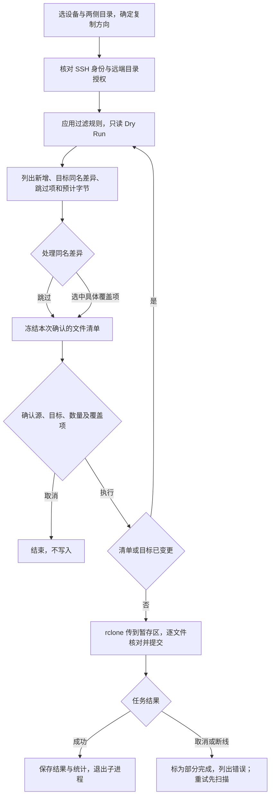

# 手动复制：一次预览对应一次写入

Sync 一次执行一个 Profile。工作台逐文件比较内容，通过 rclone 1.72.1 的 SFTP 后端传输已批准的清单，保留目标独有文件。上传跳过已有冲突；Windows 下载可逐项批准替换。[如何创建目录对、预览和批准](SYNC_USE.md)

**Profile 持久化字段：** 稳定 ID、显示名称、设备 ID、本地与远程根目录、单向方向（哪一侧是源）、模式（手动增量复制）、排除规则、删除策略（保留）、冲突策略（跳过或明确确认）、最近同步状态。设备项引用安全凭证；预览、Profile 和日志都不保存凭证明文。

- **目录边界。** 用户选择两侧根目录。扫描前须确认本轮独占远端目录、祖先及暂存区，或由管理员核实该账号的 SFTP `/` 已隔离到获准范围且暂存区私有。只有后一种授权可持久保存；无法确认时取消，既不打开 SFTP 也不启动 rclone。本地与 SFTP 路径分别解析，跳过符号链接和 junction。默认排除 `.git`、`build`、`target`、`out`，规则可编辑。
- **覆盖规则。** 展开所有可能覆盖的目标，默认跳过。批准覆盖要绑定到具体路径和预览时的目标版本。执行不得扩大到扫描后新增的源文件；准备写入时版本不符，停止该项并重新预览。无法可靠判断版本或无法排除并发目标写入时，保留现有目标、报告冲突。不得仅凭一次 Dry Run 就放开整目录写入。
- **取消与恢复。** 取消时终止并回收本次 rclone，保留已发布文件，记录已完成数量与错误。重试需重新预览和确认。当前 rclone 1.72.1 + SFTP 路径按文件恢复：内容未变的已完成文件跳过；未完成的大文件从第 0 字节重传。4 MiB 文件传至 2 MiB 时断线，上传和下载都得到这一结果。[实测偏移与字节数](../testing/SYNC_ENGINE.md#断线后从哪里重传)
- **后续。** 第一版不调用 `sync`、`bisync` 或定时扫描。双向传播删除、并发修改及中断恢复须用可丢弃目录单独验收后才能开放。
