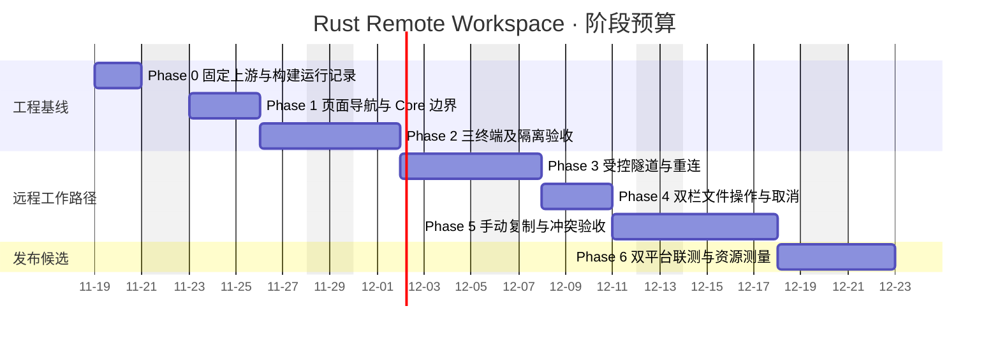

# 单人顺序开发的工期估算

以 2026-11-19 为估算起点，按工作日排期（排除周末，不计等待授权、设备排队和假期）。下图是预算，实际进度看[任务台账](../agent/TASKS.md)。上游依赖首次构建、三会话实测和同步覆盖策略是最可能改变估算的三处。

原双平台估算共 24 个工作日。本轮只交付 Windows 本机版；Linux 暂缓，Phase 3 的真实跨 NAT 验收按用户决定跳过。
